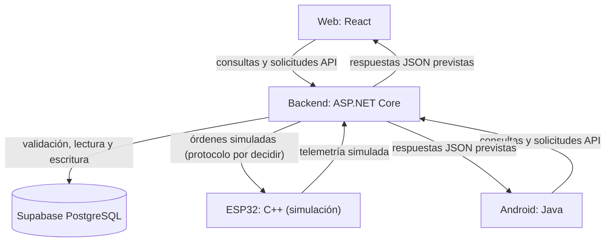

# ADR-001 — Arquitectura inicial de AhorraTenergia

- **Estado:** Propuesta para revisión del equipo (no aprobada como ADR definitiva)
- **Fecha:** 17/10/2026
- **Autor de la propuesta:** Raúl Sánchez Ortiz (responsable técnico; documentación preparada con asistencia)
- **Sprint:** 1 (06/10/2026–20/10/2026)
- **Issue:** #11

## 1. Contexto y objetivo

AhorraTenergia es un prototipo de supervisión y gestión energética para viviendas con producción solar y almacenamiento. Este documento describe las responsabilidades y los flujos previstos de la **arquitectura inicial centralizada**, para que el equipo pueda revisarlos antes de implementarlos.

El MVP usará **mediciones, precios y órdenes simulados**. No se conectará ni realizará conmutación sobre instalaciones eléctricas domésticas reales.

## 2. Componentes y responsabilidades

| Componente | Tecnología | Responsabilidad prevista |
| --- | --- | --- |
| Backend | ASP.NET Core / C# | API, validación, lógica de negocio, coordinación de decisiones simuladas y acceso a datos |
| Aplicación web | React | Consultar y visualizar consumo, producción, batería, precios y modos mediante la API |
| Aplicación móvil | Android / Java | Consultar información y solicitar cambios de modo simulados mediante la API |
| Persistencia | Supabase / PostgreSQL | Guardar mediciones, marcas temporales y estado/decisiones simuladas |
| Dispositivo de prototipo | ESP32 / C++ | Generar telemetría simulada y representar recepción/ejecución de órdenes simuladas |

Las interfaces **no deben acceder directamente** a la base de datos ni enviar órdenes directamente a la ESP32. El backend actúa como mediador único.

## 3. Diagrama de arquitectura (lógico, no despliegue definitivo)

Las flechas representan **responsabilidades lógicas**. No implican que ya exista conexión funcional ni determinan todavía protocolos concretos.

## 4. Flujos previstos

1. **ESP32 → backend.** El prototipo genera lecturas simuladas de consumo, producción solar o batería y las entrega al backend por un mecanismo aún por decidir.
2. **Backend → persistencia.** El backend comprueba formato, unidades, identificador y marca temporal, rechaza entradas inválidas y almacena lecturas aceptadas en PostgreSQL a través de la integración de datos que se implemente.
3. **Consulta para decisiones.** El backend obtiene mediciones recientes, estado y precio (simulado en el MVP); aplica reglas de negocio aún por concretar. Las decisiones se registrarán cuando el modelo de datos lo permita.
4. **Backend → ESP32.** Si una regla o una solicitud autorizada requiere una acción, el backend genera una **orden simulada** que la ESP32 representa sin accionar elementos eléctricos físicos. El mecanismo de envío, confirmación y reintentos queda pendiente.
5. **Web/Android ↔ API.** Las interfaces solicitan por API la telemetría, el historial y el modo de operación. Los cambios de modo generan solicitudes al backend; no accesos directos a hardware o base de datos.

Un conjunto inicial de datos de ejemplo podría contener `timestamp`, `homeId`, `consumptionKw`, `solarProductionKw`, `batteryPercent`, `electricityPriceEurKwh` y `mode`. **Estos nombres son ejemplos para discusión, no un contrato API ni un esquema aprobado.** Se distinguirán magnitudes instantáneas (kW) de energía acumulada (kWh).

## 5. Decisiones y aspectos pendientes

### Confirmado para la propuesta inicial

- Pila tecnológica prevista: ASP.NET Core (C#), React, Android Java, Supabase PostgreSQL y ESP32 C++.
- Arquitectura centralizada: el backend concentra la lógica, coordina las interfaces y el dispositivo, y gestiona la persistencia.
- Primer MVP **totalmente simulado**, sin maniobras eléctricas reales.
- Los tres integrantes colaboran en backend y frontend, con responsabilidades principales diferenciadas.

### Pendiente de valoración y aprobación del equipo

- Proveedor de alojamiento del backend, entorno y estrategia de despliegue.
- Autenticación, autorización, gestión de sesiones y permisos de cada aplicación/dispositivo.
- Protocolo ESP32–backend (por ejemplo, HTTP o MQTT), transporte seguro, identificación, tratamiento de fallos y mensajes.
- Fuente real de precios de electricidad, licencia, actualización, zona horaria y modo de prueba.
- Esquema PostgreSQL definitivo, retención de históricos y estrategia de migraciones.
- Contrato exacto de la API, versionado, notificación de cambios y manejo de errores.
- Algoritmo/reglas de decisión, prioridades y cómo representar órdenes simuladas.

**Ninguno de estos puntos se considera decidido por publicar este archivo.** La revisión y la aceptación de la ADR deben registrarse por el equipo.

## 6. Límites, seguridad y pruebas

- No conectar relés, contactores, inversores, cuadros eléctricos ni cableado de una vivienda para efectuar conmutaciones reales.
- No habilitar control de alimentación eléctrica mediante el prototipo; todas las órdenes son representaciones de software.
- No guardar tokens, claves ni cadenas de conexión en Git; usar configuración segura cuando se implemente el backend.
- Verificar con datos ficticios: validación de entradas, persistencia y recuperación de muestras, reglas simuladas, respuestas API y rechazo de órdenes inválidas.
- Una demostración de pantallas o diagramas no equivale a integración funcional; cada tarea se cerrará solo con evidencia propia comprobada.

## 7. Criterios de aceptación de la ADR

- [x] Cinco componentes y sus funciones descritos.
- [x] Backend identificado como punto central.
- [x] Diagrama y cinco flujos lógicos incluidos.
- [x] Separación explícita entre acuerdos y decisiones pendientes.
- [x] Exclusión de maniobras eléctricas reales.
- [ ] Revisada por Hebert o Noa en Pull Request.
- [ ] Aprobada e incorporada a `main` tras revisión.

## 8. Referencias

- Issue de arquitectura: [#11](https://github.com/rrrarrra9/AhorraTenergia/issues/11).
- Planificación Sprint 1: [#5](https://github.com/rrrarrra9/AhorraTenergia/issues/5).
- Visión del proyecto: [README](../../README.md).
