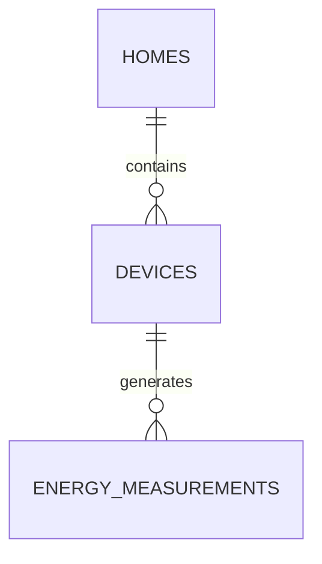

# Sprint 2 — Modelo de datos y contrato de comunicación

**Proyecto:** AhorraTenergia  
**Sprint:** 2 — Primer incremento funcional del MVP  
**Fecha de entrega:** 12/11/2026  
**Estado:** Propuesta consolidada para revisión del equipo  
**Issue relacionado:** #38

## 1. Objetivo

Este documento define el contrato común que utilizarán los componentes de AhorraTenergia durante el Sprint 2.

Su finalidad es evitar que Backend, React, Supabase y ESP32 utilicen nombres, unidades o estructuras diferentes durante el desarrollo.

El flujo funcional que se pretende demostrar es:

**ESP32 simulada → ASP.NET Core → Supabase → ASP.NET Core → React**

ASP.NET Core actúa como componente central del sistema.

React y ESP32 no deben acceder directamente a Supabase.

---

# 2. Alcance del Sprint 2

Durante este sprint se implementará un primer incremento funcional y demostrable.

Se trabajará inicialmente con:

- una vivienda;
- una ESP32 simulada;
- telemetría energética simulada;
- Backend ASP.NET Core;
- Supabase PostgreSQL;
- dashboard React;
- precio eléctrico simulado;
- histórico energético básico.

Identificadores utilizados inicialmente:

```text
homeId = "home-01"
deviceId = "esp32-01"
```

Estos identificadores corresponden únicamente al escenario inicial de pruebas.

El modelo debe permitir ampliar posteriormente el sistema a varias viviendas y dispositivos.

---

# 3. Casos de uso mínimos

## CU-01 — Generar telemetría energética simulada

La ESP32 genera periódicamente datos simulados que representan el estado energético de una vivienda.

Los datos incluyen:

- consumo eléctrico;
- producción solar;
- nivel de batería;
- potencia de batería;
- intercambio con la red;
- identificadores;
- fecha y hora.

La ESP32 no calcula inicialmente el precio eléctrico ni decide el modo del sistema.

---

## CU-02 — Recibir y almacenar una medición

ASP.NET Core recibe mediante su API la telemetría generada por la ESP32.

El Backend debe:

1. recibir el mensaje;
2. validar su formato;
3. validar los valores básicos;
4. comprobar los identificadores;
5. incorporar los datos gestionados por el Backend;
6. almacenar la medición en Supabase.

Durante el Sprint 2 toda la información es simulada y no procede de una instalación eléctrica real.

---

## CU-03 — Consultar el estado energético actual

React solicita al Backend la última medición energética disponible.

El Backend recupera la información almacenada y devuelve un objeto JSON con el estado actual.

React representa al menos:

- consumo;
- producción solar;
- batería;
- intercambio con la red;
- precio eléctrico simulado;
- modo del sistema.

---

## CU-04 — Consultar histórico energético básico

React solicita al Backend varias mediciones anteriores.

El Backend consulta Supabase y devuelve un conjunto limitado de registros ordenados temporalmente.

El dashboard utiliza esos datos para representar la evolución básica de consumo y producción solar.

---

# 4. Convenciones generales

## 4.1 Nombres

Se utilizarán las siguientes convenciones:

| Entorno | Convención |
|---|---|
| JSON | `camelCase` |
| C# | `PascalCase` |
| PostgreSQL / Supabase | `snake_case` |

Ejemplo:

| Concepto | JSON | C# | PostgreSQL |
|---|---|---|---|
| Consumo | `consumptionPowerKw` | `ConsumptionPowerKw` | `consumption_power_kw` |
| Producción solar | `solarProductionPowerKw` | `SolarProductionPowerKw` | `solar_production_power_kw` |

---

## 4.2 Unidades

| Magnitud | Unidad |
|---|---|
| Potencia instantánea | kW |
| Energía acumulada | kWh |
| Nivel de batería | % |
| Precio de electricidad | €/kWh |
| Fecha/hora | UTC — ISO 8601 |

En el Sprint 2 los valores principales enviados por la ESP32 representan **potencias instantáneas**, por lo que se expresan en **kW**, no en kWh.

---

# 5. Diccionario de datos

## 5.1 Datos generados por la ESP32

### `homeId`

Identificador de la vivienda asociada a la medición.

Ejemplo:

```text
home-01
```

Tipo lógico:

```text
string
```

---

### `deviceId`

Identificador del dispositivo que genera la medición.

Ejemplo:

```text
esp32-01
```

Tipo lógico:

```text
string
```

---

### `timestamp`

Fecha y hora correspondiente a la medición.

Debe utilizar UTC y formato ISO 8601.

Ejemplo:

```text
2026-11-05T16:30:00Z
```

---

### `consumptionPowerKw`

Potencia eléctrica consumida por la vivienda en ese instante.

Unidad:

```text
kW
```

Debe ser igual o superior a cero.

---

### `solarProductionPowerKw`

Potencia producida por la instalación solar simulada.

Unidad:

```text
kW
```

Debe ser igual o superior a cero.

---

### `batteryLevelPercent`

Nivel de carga de la batería.

Unidad:

```text
%
```

Rango válido:

```text
0 - 100
```

---

### `batteryPowerKw`

Potencia intercambiada con la batería.

Interpretación:

- valor positivo: la batería entrega energía;
- valor negativo: la batería se está cargando;
- cero: no existe intercambio.

Unidad:

```text
kW
```

---

### `gridPowerKw`

Potencia intercambiada con la red eléctrica.

Interpretación:

- valor positivo: importación o consumo desde la red;
- valor negativo: exportación de excedente;
- cero: sin intercambio.

Unidad:

```text
kW
```

---

## 5.2 Datos gestionados por el Backend

### `electricityPriceEurKwh`

Precio de electricidad utilizado por el sistema.

Durante el Sprint 2 será un valor simulado.

Unidad:

```text
€/kWh
```

La ESP32 no enviará este dato.

---

### `systemMode`

Modo lógico del sistema.

Valores previstos inicialmente:

```text
automatic
manual
```

Durante el primer incremento puede utilizarse un valor simulado o configurado por el Backend.

La ESP32 no enviará este dato.

El dashboard podrá representarlo, pero el control completo del modo no forma parte del flujo mínimo obligatorio de este sprint.

---

# 6. Contrato ESP32 → Backend

La ESP32 enviará la telemetría al Backend mediante:

```text
POST /api/telemetry
```

Formato:

```json
{
  "homeId": "home-01",
  "deviceId": "esp32-01",
  "timestamp": "2026-11-05T16:30:00Z",
  "consumptionPowerKw": 2.35,
  "solarProductionPowerKw": 1.80,
  "batteryLevelPercent": 68,
  "batteryPowerKw": 0.40,
  "gridPowerKw": 0.15
}
```

La ESP32 no enviará:

- `electricityPriceEurKwh`;
- `systemMode`.

Estos valores son responsabilidad del Backend.

---

# 7. Validaciones mínimas del Backend

Para aceptar una medición, el Backend debe comprobar al menos:

- `homeId` informado;
- `deviceId` informado;
- `timestamp` válido;
- fecha y hora interpretables como UTC;
- `consumptionPowerKw >= 0`;
- `solarProductionPowerKw >= 0`;
- `batteryLevelPercent` entre 0 y 100;
- `batteryPowerKw` numérico;
- `gridPowerKw` numérico;
- existencia del dispositivo;
- relación válida entre dispositivo y vivienda.

No se establecen todavía límites máximos físicos estrictos para las potencias, ya que el sistema utiliza datos simulados.

El simulador deberá generar valores razonables y coherentes para la demostración.

---

# 8. Contrato Backend → React

El Backend devolverá a React los datos energéticos enriquecidos con la información gestionada por el propio Backend.

Ejemplo:

```json
{
  "homeId": "home-01",
  "deviceId": "esp32-01",
  "timestamp": "2026-11-05T16:30:00Z",
  "consumptionPowerKw": 2.35,
  "solarProductionPowerKw": 1.80,
  "batteryLevelPercent": 68,
  "batteryPowerKw": 0.40,
  "gridPowerKw": 0.15,
  "electricityPriceEurKwh": 0.18,
  "systemMode": "automatic"
}
```

React deberá utilizar los mismos nombres definidos en este contrato.

---

# 9. API mínima del Sprint 2

Solo se consideran necesarios inicialmente los siguientes endpoints.

## `POST /api/telemetry`

Recibe una nueva medición procedente de la ESP32 simulada.

Flujo:

```text
ESP32
  ↓
POST /api/telemetry
  ↓
ASP.NET Core
  ↓
validación
  ↓
Supabase
```

Resultados mínimos esperados:

- medición válida → aceptada y almacenada;
- JSON incorrecto → error de cliente;
- valores inválidos → error de validación;
- error interno o de persistencia → error del servidor.

No es necesario diseñar en este sprint un sistema complejo de códigos de error personalizados.

---

## `GET /api/energy/current`

Devuelve la última medición energética disponible.

Respuesta esperada:

```json
{
  "homeId": "home-01",
  "deviceId": "esp32-01",
  "timestamp": "2026-11-05T16:30:00Z",
  "consumptionPowerKw": 2.35,
  "solarProductionPowerKw": 1.80,
  "batteryLevelPercent": 68,
  "batteryPowerKw": 0.40,
  "gridPowerKw": 0.15,
  "electricityPriceEurKwh": 0.18,
  "systemMode": "automatic"
}
```

---

## `GET /api/energy/history?limit=20`

Devuelve las últimas mediciones disponibles.

Ejemplo conceptual:

```json
[
  {
    "homeId": "home-01",
    "deviceId": "esp32-01",
    "timestamp": "2026-11-05T16:30:00Z",
    "consumptionPowerKw": 2.35,
    "solarProductionPowerKw": 1.80,
    "batteryLevelPercent": 68,
    "batteryPowerKw": 0.40,
    "gridPowerKw": 0.15,
    "electricityPriceEurKwh": 0.18,
    "systemMode": "automatic"
  }
]
```

El parámetro `limit` permite limitar la cantidad de registros recuperados.

Para la demostración inicial se utilizará:

```text
limit=20
```

---

## `GET /api/health`

Permite comprobar que el Backend está operativo.

Respuesta mínima prevista:

```json
{
  "status": "ok"
}
```

Este endpoint no representa lógica energética.

---

# 10. Modelo entidad-relación inicial

El DER mínimo del Sprint 2 contiene tres entidades:

- `homes`
- `devices`
- `energy_measurements`

Relaciones:

```text
homes 1:N devices

devices 1:N energy_measurements
```

Representación:



Este DER es deliberadamente pequeño.

No representa todavía el modelo completo que tendrá AhorraTenergia en versiones posteriores.

---

# 11. Esquema lógico inicial

## `homes`

Representa una vivienda.

| Campo | Tipo propuesto | Restricción |
|---|---|---|
| `id` | `text` | PK |

Registro inicial:

```text
home-01
```

---

## `devices`

Representa un dispositivo asociado a una vivienda.

| Campo | Tipo propuesto | Restricción |
|---|---|---|
| `id` | `text` | PK |
| `home_id` | `text` | FK → `homes.id`, NOT NULL |

Registro inicial:

```text
id = esp32-01
home_id = home-01
```

---

## `energy_measurements`

Representa una medición energética.

| Campo | Tipo propuesto | Restricción |
|---|---|---|
| `id` | `bigint` | PK, generado automáticamente |
| `device_id` | `text` | FK → `devices.id`, NOT NULL |
| `timestamp` | `timestamptz` | NOT NULL |
| `consumption_power_kw` | `numeric` | NOT NULL |
| `solar_production_power_kw` | `numeric` | NOT NULL |
| `battery_level_percent` | `numeric` | NOT NULL |
| `battery_power_kw` | `numeric` | NOT NULL |
| `grid_power_kw` | `numeric` | NOT NULL |
| `electricity_price_eur_kwh` | `numeric` | NOT NULL |
| `system_mode` | `text` | NOT NULL |

Los tipos SQL concretos podrán ajustarse durante la implementación si PostgreSQL/Supabase requiere una precisión determinada.

No debe cambiarse el significado ni la unidad de los campos sin actualizar previamente este contrato.

---

# 12. Decisión sobre precio y modo en el modelo inicial

Durante el Sprint 2 se almacenarán:

- `electricity_price_eur_kwh`;
- `system_mode`;

junto con cada medición.

Esto permite recuperar un histórico coherente sin añadir nuevas entidades durante este sprint.

Esta decisión es deliberadamente simple.

En futuras iteraciones se podrá estudiar la normalización del modelo mediante entidades específicas para:

- tarifas;
- precios;
- modos;
- órdenes;
- reglas;
- decisiones del sistema.

---

# 13. Responsabilidades de los componentes

## ESP32 / C++

Responsable principal: Hebert.

Debe:

- generar telemetría simulada;
- respetar el contrato JSON;
- utilizar las unidades acordadas;
- generar valores coherentes;
- mostrar inicialmente los mensajes mediante puerto serie;
- enviar posteriormente los mensajes al Backend.

No debe:

- conectarse directamente a Supabase;
- conectarse directamente a React;
- gestionar usuarios;
- obtener precios eléctricos reales;
- realizar conmutaciones eléctricas.

---

## Backend ASP.NET Core

Responsable principal: Raúl.

Debe:

- exponer la API;
- recibir la telemetría;
- validar los mensajes;
- aplicar las reglas mínimas necesarias;
- gestionar precio y modo simulados;
- persistir las mediciones;
- consultar Supabase;
- devolver información a React.

ASP.NET Core es el mediador central del sistema.

---

## Supabase PostgreSQL

Debe:

- almacenar viviendas;
- almacenar dispositivos;
- almacenar mediciones energéticas;
- permitir al Backend insertar y consultar información.

No debe ser accedido directamente por React ni por ESP32.

---

## React

Responsable principal: Noa.

Debe:

- implementar el dashboard;
- utilizar inicialmente mocks que respeten este contrato;
- consultar posteriormente la API;
- mostrar el estado energético actual;
- representar el histórico básico.

React no debe acceder directamente a Supabase.

---

# 14. Estrategia de integración

La integración se realizará progresivamente.

## Fase 1 — Contrato común

Los tres integrantes revisan y aprueban este documento.

---

## Fase 2 — Desarrollo paralelo

Raúl desarrolla el Backend.

Noa desarrolla React utilizando mocks compatibles.

Hebert desarrolla la simulación ESP32 utilizando el mismo JSON.

---

## Fase 3 — React ↔ Backend

Se sustituyen los datos mock del dashboard por llamadas a:

```text
GET /api/energy/current
GET /api/energy/history?limit=20
```

---

## Fase 4 — Backend ↔ Supabase

El Backend almacena y recupera mediciones mediante PostgreSQL/Supabase.

---

## Fase 5 — ESP32 → Backend

La ESP32 envía el JSON definido mediante:

```text
POST /api/telemetry
```

---

## Fase 6 — Flujo completo

Resultado esperado:

```text
ESP32
  ↓
ASP.NET Core
  ↓
Supabase
  ↓
ASP.NET Core
  ↓
React
```

---

# 15. Seguridad

No se versionarán en GitHub:

- contraseñas;
- tokens;
- API keys;
- credenciales;
- cadenas de conexión privadas;
- archivos `.env`;
- datos personales reales.

Cuando sea necesario documentar configuración se utilizarán archivos de ejemplo sin secretos.

Ejemplo:

```text
.env.example
```

La configuración real deberá permanecer fuera del repositorio.

La carpeta de pruebas no se considera insegura por su mera existencia.

Debe verificarse que tests, fixtures y configuraciones no contengan información sensible.

---

# 16. Fuera del alcance del Sprint 2

No forman parte del incremento mínimo:

- autenticación;
- usuarios reales;
- aplicación Android;
- precios eléctricos reales;
- control físico de instalaciones;
- relés;
- conmutación eléctrica;
- reglas automáticas avanzadas;
- notificaciones;
- gestión completa de varias viviendas;
- gestión completa de varios dispositivos;
- automatización avanzada.

---

# 17. Evolución futura del modelo

En futuras iteraciones deberá estudiarse la incorporación de:

- usuarios;
- autenticación;
- relación usuario-vivienda;
- varias viviendas;
- varios dispositivos;
- placas solares;
- baterías;
- tarifas;
- precios eléctricos reales;
- órdenes hacia dispositivos;
- reglas automáticas;
- modos manual y automático completos;
- notificaciones;
- estadísticas;
- aplicación Android;
- registro de decisiones del sistema.

Estas funcionalidades no deben introducirse anticipadamente en el modelo del Sprint 2 salvo necesidad técnica justificada.

---

# 18. Criterio de éxito

El incremento del Sprint 2 se considerará técnicamente satisfactorio cuando pueda demostrarse:

```text
ESP32 genera telemetría simulada
        ↓
ASP.NET Core recibe y valida
        ↓
Supabase almacena
        ↓
ASP.NET Core recupera
        ↓
React representa los datos
```

No es necesario terminar AhorraTenergia completo para considerar válido este sprint.

---

# 19. Aprobación del contrato

Antes de comenzar la integración, el equipo debe comprobar que:

- [ ] Los casos de uso están aceptados.
- [ ] Los nombres de los campos están aceptados.
- [ ] Las unidades están aceptadas.
- [ ] El DER está aceptado.
- [ ] El esquema lógico inicial está aceptado.
- [ ] El contrato ESP32 → Backend está aceptado.
- [ ] El contrato Backend → React está aceptado.
- [ ] Los cuatro endpoints mínimos están aceptados.
- [ ] Las responsabilidades de los componentes están claras.
- [ ] No existen secretos ni credenciales en el documento.
- [ ] Raúl, Noa y Hebert comprenden el mismo contrato.

Una vez revisado mediante Pull Request y aprobado formalmente por otro integrante, este documento será la referencia técnica común para el desarrollo del Sprint 2.
